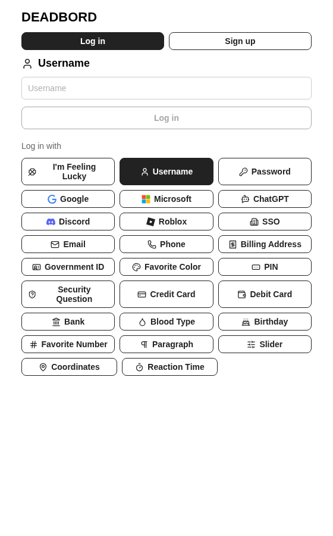
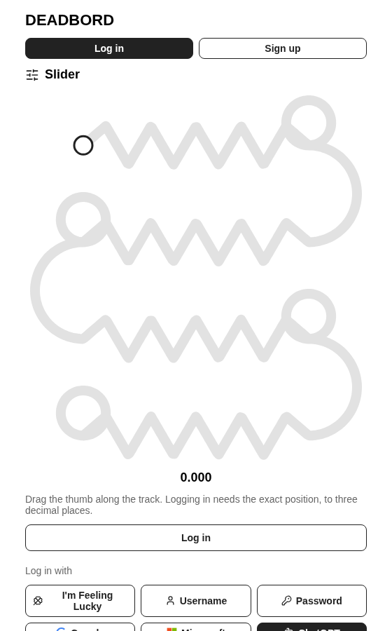
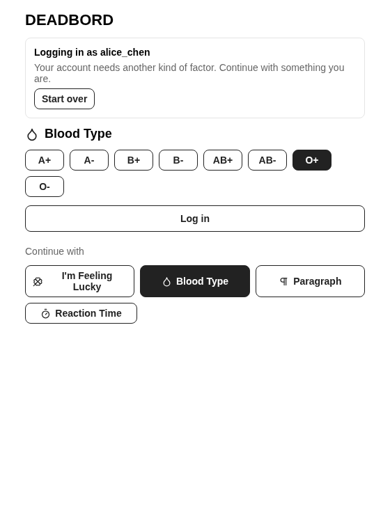
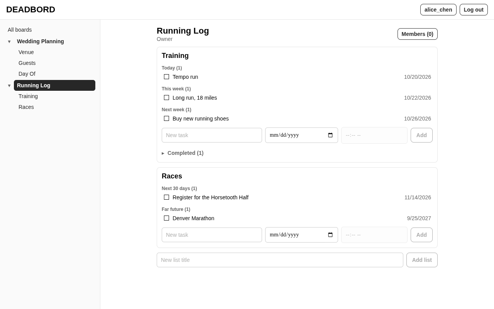
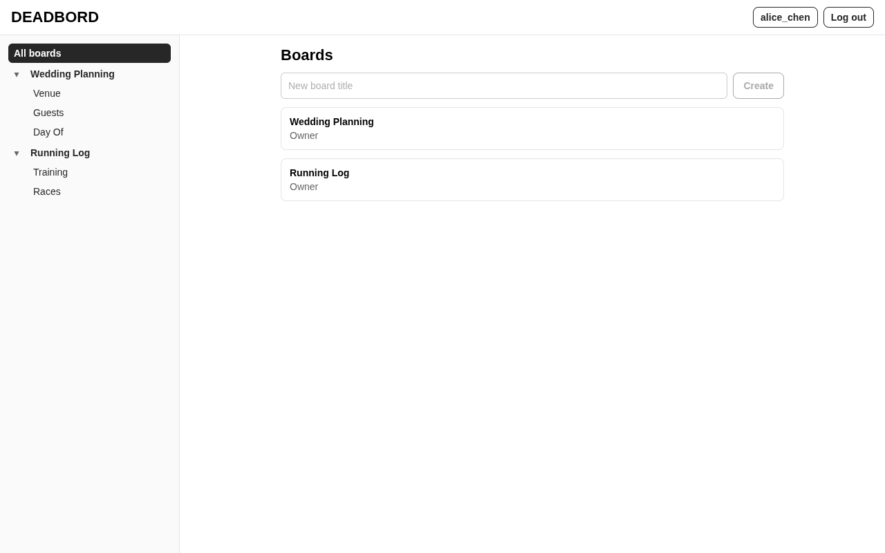

# DEADBORD

A to-do list app with boards, lists and tasks, shareable with other users, and a deliberately over-the-top set of login methods. You can sign in with anything from a password to your blood type, a giant looping slider, or a spot on a map.

📄 **Documentation and spec:** [Todo List on Notion](https://app.notion.com/p/Todo-List-3f8c26680a458004983de936ca6076fb?source=copy_link)

## Screenshots

| Logging in | Picking a slider position | A second factor |
|---|---|---|
|  |  |  |

Boards, with tasks grouped by when they're due:





## What's in it

- **Boards, lists and tasks.** Tasks have due dates and comments and are grouped into Overdue, Today, Tomorrow, This week, Next week, Next 30 days and Far future. Boards can be shared with other users, with per-board permissions.
- **About 25 login methods:**
  - OAuth: Google, Microsoft, Discord, Roblox and ChatGPT.
  - SSO, which picks the OAuth provider from your email's domain.
  - Email codes sent over SMTP.
  - Form-based methods: password, PIN, security question, phone, card, bank, birthday, favorite color, slider, coordinates, blood type, reaction time, paragraph and more.
- **Multi-factor login.** Users can require 1 to 3 kinds of factor (something you know, have or are) in their account settings.
- **TDLP.** The desktop app gets board data over TDLP, a custom encrypted UDP protocol (`TDLP/`). Auth and accounts use HTTP.

## Layout

| Path | What |
|---|---|
| `backend/` | Fastify + MongoDB server: HTTP auth API and the TDLP UDP server |
| `frontend/` | Expo / React Native app (web, mobile) and the Electron desktop app |
| `TDLP/` | The TDLP, LMP and TLON protocol libraries |

## Running it

You need Node.js 24+ and a MongoDB server.

```sh
# Backend
cd backend
npm install
cp .env.example .env        # fill in MONGO_*, AUTH_SECRET (openssl rand -hex 32), and optionally SMTP / OAuth
npm run tdlp:keygen         # RSA key pair for TDLP
npm run db:setup            # collections, schemas and indexes
npm run db:seed             # optional: demo users, boards and tasks
npm run dev                 # HTTP on :3000, TDLP on udp :3001

# Frontend (in another terminal)
cd frontend
npm install
npm run web                 # Expo web dev server on :8081 (login and account only)
npm run desktop:dev         # Electron app against the dev server (needed for boards)
```

The desktop app's server address can be changed from the login screen (**Server → Change**) or with the `DEADBORD_API_URL`, `DEADBORD_TDLP_HOST` and `DEADBORD_TDLP_PORT` environment variables.

Without SMTP settings, email login codes are printed to the backend log.
